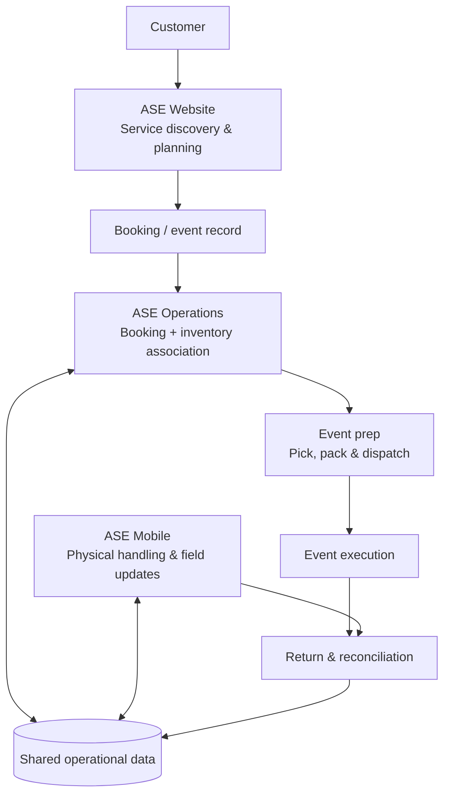

# Aniah Social Events — A Connected Booking & Inventory Ecosystem

**Case study · Website, operations dashboard, and mobile companion**

Aniah Social Events plans and styles celebrations. The work starts when a customer looks at services and continues through booking, equipment prep, the event itself, and inventory return. The business runs on three products that share one operational picture:

1. **Customer-facing website** — services, packages, portfolios, and the path into booking or planning.
2. **Inventory and booking system** — physical inventory, storage locations, and the items each booking needs.
3. **Mobile companion** — warehouse and field workflows for items, labels, pickup, and return.

A booking is a commitment to specific pieces, quantities, and handoffs. The system tracks those pieces from the moment they are reserved through the moment they come back.

## The problem

The customer sees a styled event. The team has to know which decor pieces are included, where they are stored, what is going out, and what comes back.

When that information lives in spreadsheets, messages, and memory, basic questions get hard to answer. What is needed for this event? Where is each item? Has it been packed? Did it return? Can this item be committed to another booking?

## The solution: three connected products

### 1. Aniah Social Events website

**Repository:** [agustindevelops/aniah-social-events](https://github.com/agustindevelops/aniah-social-events)  
**Live:** [aniahsocialevents.com](https://www.aniahsocialevents.com/)

The public site presents intimate celebrations, wedding and event services, portfolios, and contact and planning paths. A visitor can browse the work, understand the offer, and start a conversation about a celebration. The site communicates the service and the experience. The internal platform turns that experience into fulfillment requirements.

The site is built with Next.js, React, TypeScript, Tailwind CSS, and Contentful, with media handled through an S3-compatible store.

### 2. ASE inventory and booking system

**Repository:** [agustindevelops/ase-wms-web](https://github.com/agustindevelops/ase-wms-web)

The back office connects bookings to the physical pieces required to fulfill them. It holds the inventory catalog and gives staff a structured view of what is available, where it belongs, and how it relates to event work.

Items carry photos, labels, and QR identification, and they sit in a hierarchy of storage locations. Bookings treat inventory as reusable assets tied to real event commitments.

**What the system handles:**

- Items with images and identifying information.
- Storage locations arranged so a physical piece can be found.
- Booked services and events linked to the inventory they require.
- Pickup and return as part of the event lifecycle.
- A shared record the mobile companion works against.

The operations app is built with Next.js, React, Prisma, PostgreSQL, Firebase, and Cloudflare R2.

### 3. ASE mobile companion

**Repository:** [agustindevelops/ase-wms-app](https://github.com/agustindevelops/ase-wms-app)

The mobile app brings the inventory workflow to the places staff actually handle equipment: the storage area, the loading process, the venue, and the return. It sits alongside the administrative web app.

An item can be identified and updated in context, while the team is standing with the equipment.

**Workflows:**

- Identify inventory from item labels or QR codes.
- Check item and location details while collecting equipment.
- Work through pickup and return tasks for an event.
- Keep operational status aligned with the central system.

## How the products work together

### Example: a styled dinner booking

1. **Discover** — A customer views a styled celebration on the website and starts the booking process.
2. **Plan** — The event is recorded as a booking with the relevant package or requested setup.
3. **Translate into assets** — The operations system connects that booking to specific pieces: linens, tableware, decor, lighting, props, and anything else included.
4. **Locate and prepare** — Staff use the catalog, item identifiers, and storage hierarchy to gather what the event needs.
5. **Handle in the field** — The mobile app stays with staff through pickup, transport, and return.
6. **Close the loop** — Returned pieces are reconciled with the operational record, so the booked event and the equipment that left the warehouse stay in agreement.

One customer experience, one operational record, and two interfaces for doing the work.

## Architecture and design decisions

| Concern | Approach | Why it matters |
| --- | --- | --- |
| Customer journey | Dedicated public website | Brand, discovery, services, and conversion stay on a site built for visitors. |
| Operations | Separate inventory and booking system | The internal model stays off the public site. |
| Physical workflows | Mobile companion | Item handling happens where the equipment is. |
| Item identity | Catalog records, locations, labels, and QR codes | A warehouse object and its database row refer to the same thing. |
| Event-to-inventory relationship | Bookings associated with reusable assets | A sales commitment becomes a fulfillment list. |
| Content | Contentful on the website | Service pages and imagery are managed as content. |
| Persistence and media | PostgreSQL with Prisma, Cloudflare R2 | Structured records and images are stored separately. |

The public site shows the customer what they are buying. The admin product reads that purchase as an event with physical requirements. The mobile product makes those requirements usable while staff are handling inventory. Each product serves a different person in the same business process.

## Engineering challenges

**Reusable inventory against changing events.** A booking is temporary. An asset is used again and again. Keeping those relationships coherent is the hard part of the model.

**Physical and digital identity.** Labels, QR codes, photos, and nested storage locations make a database row useful to someone standing in a warehouse looking for a piece.

**Different working environments.** The public website, the office dashboard, and the mobile app have different users and different interaction patterns. Their responsibilities stay distinct while the underlying records stay connected.

**Marketing content and operational data.** Service descriptions and imagery are content. Bookings, inventory associations, locations, and item status are transactional. Keeping those domains apart lets each interface change on its own.

## Outcome

The ecosystem is the path from selling an event, to preparing it, to accounting for the assets afterward. It covers customer experience, day-to-day operations, the inventory model, and the mobile workflows that execute the work.

## Repositories

| Component | Source |
| --- | --- |
| Customer website | [GitHub](https://github.com/agustindevelops/aniah-social-events) · [Live site](https://www.aniahsocialevents.com/) |
| Inventory and booking | [ase-wms-web](https://github.com/agustindevelops/ase-wms-web) |
| Mobile companion | [ase-wms-app](https://github.com/agustindevelops/ase-wms-app) |
